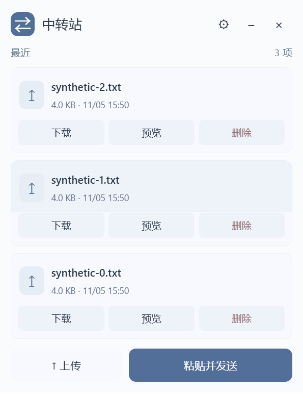

# Personal File Relay — self-hosted files, images and text on Windows

Personal File Relay turns a Windows computer into a personal relay for files, images and text. Windows, Mac and Android devices connect through a browser. An optional compact Windows client adds clipboard sending, drag-and-drop uploads and configurable global shortcuts. Files remain on the host computer.

[中文说明](README.md) · [Download Windows client](https://github.com/vence15008-ai/personal-file-relay-public/releases/latest) · [Client quick start, Chinese](desktop/windows/QUICKSTART.zh-CN.md)

This is an independent customization of **FileBrowser Quantum v2.0.2-stable**, not an official upstream release or the legacy File Browser application. Source and client releases are public. Deploy your own host and sign in with your own file-service account; publishing source does not grant access to anyone's files. See [MODIFICATIONS.md](MODIFICATIONS.md) for the changes from upstream.

## Features

- A unified list of files and text messages: three recent entries by default, with scrollable history.
- Click a message or its metadata to copy the entire text. Fullscreen preview allows selecting and copying part of it.
- Paste and send text or clipboard images without a text composer. Images use the existing upload queue.
- File drag-and-drop, flat download/preview/delete actions and chunked uploads.
- A roughly 340px Windows window with an integrated header, light/dark palette, taskbar/tray access and configurable shortcuts.
- Browser access and an installable Web App where the browser supports it. Android has no standalone APK; macOS has no native package.



The screenshot contains synthetic test files. Desktop blur depends on Windows support and transparency settings.

## Host versus client

| Role | Software | Responsibility |
| --- | --- | --- |
| Windows host | Customized native Quantum service; Tailscale Funnel for public HTTPS | Stores files/messages and enforces application authentication |
| Windows client | Browser or optional x64 portable desktop package | Connects to the host, without running a file server or Tailscale |
| Mac / Android | Browser; optional home-screen Web App | Uses the same HTTPS URL |

Only the host runs Tailscale. A phone does not need to install or switch to Tailscale. Compatibility with its existing VPN and mobile network must still be tested on the actual phone.

## Start on another computer

1. Download `PersonalRelay-Client-*-win-x64.zip` from [Releases](https://github.com/vence15008-ai/personal-file-relay-public/releases/latest), extract the entire archive and run `RelayClient.exe`.
2. Open the gear settings and enter the **host's HTTPS root URL**. Do not use `127.0.0.1:18473` on a remote client; it points to that client itself.
3. Sign in using the file-service account. The Windows client requires .NET Framework 4.8 and Microsoft Edge WebView2 Runtime; use the official Microsoft links in the [quick start](desktop/windows/QUICKSTART.zh-CN.md) if either is missing.

The package targets Windows x64. It has been exercised on Windows 11 at 175% display scaling; another physical PC and Windows 10 are not yet verified. Mac and phone users can open the same HTTPS URL in their browser.

## Run your own host

Follow the [host deployment guide, Chinese](PERSONAL-RELAY.md). Build requirements are Node.js 24 and Go 1.27 or newer. The running file service needs neither toolchain, Docker, WSL nor a virtual machine.

```powershell
./deploy/build-windows.ps1
./deploy/install-host.ps1 -Root C:\PersonalFileRelay
```

Use dedicated directories, initialize the account password interactively and validate the loopback service before enabling a public entry. The service listens on `127.0.0.1:18473`; Funnel proxies it to HTTPS. No router port forwarding, exit node or subnet router is required. Funnel availability and limits are governed by [Tailscale](https://tailscale.com/kb/1223/funnel).

## Security and practical limits

**Funnel is a public internet entry, not an account-only tailnet gate.** Application authentication protects the files. The current deployment disables anonymous access, self-registration and public sharing.

Clipboard reads occur only on an explicit button, paste action or shortcut. This is not automatic clipboard synchronization or end-to-end encrypted messaging. The host must remain awake and online; performance depends on its upstream connection and Funnel limits. A personal cloud drive is not a backup.

Local tests verified synthetic 2 MiB and 200 MiB transfers with matching SHA-256 hashes, including twenty 10 MiB upload chunks. Anonymous file/message APIs were rejected. Those tests do not establish remote-network compatibility or general security; see the dated [validation record](docs/VALIDATION.md).

## Documentation and provenance

- [Desktop client, hotkeys and build instructions](DESKTOP-CLIENT.md)
- [Host and browser client installation](PERSONAL-RELAY.md)
- [FAQ, Chinese](docs/FAQ.zh-CN.md)
- [Project facts and scope](docs/PROJECT-FACTS.md)
- [Documentation navigation](llms.txt)

Upstream: [FileBrowser Quantum](https://github.com/gtsteffaniak/filebrowser), based here on v2.0.2-stable. The [archived upstream README](docs/upstream/README-quantum-v2.0.2-stable.md) describes upstream behavior, not the tested scope of this customization. [Apache-2.0](LICENSE); WebView2 dependencies retain their own license notices.
