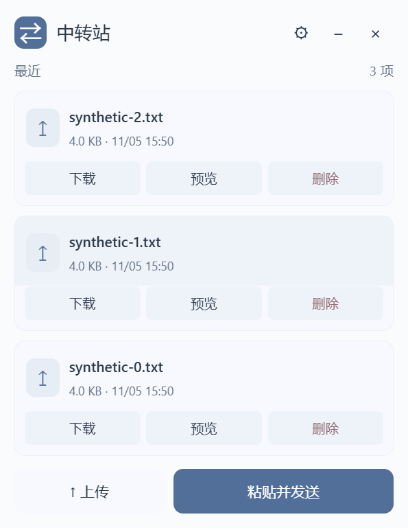

# Personal File Relay｜个人文件、图片与文字中转站

**把 Windows 电脑作为个人文件中转主机，在 Windows、Mac 和 Android / vivo 手机之间通过浏览器上传下载文件、图片与文字。** 文件留在自己的主机上；可选的窄版 Windows 客户端提供剪贴板发送、拖入上传和全局热键。

Personal File Relay is a Windows-hosted file, image and text relay built on FileBrowser Quantum, with browser/PWA access and an optional compact Windows client. [English overview](README.en.md).

[下载 Windows 客户端](https://github.com/vence15008-ai/personal-file-relay-public/releases/latest) · [副机快速开始](desktop/windows/QUICKSTART.zh-CN.md) · [主机安装](PERSONAL-RELAY.md) · [常见问题](docs/FAQ.zh-CN.md)

本仓库是 **FileBrowser Quantum v2.0.2-stable 的独立定制分支**，不是上游官方发行版，也不混用旧版 File Browser 的配置。源码及客户端 Release 公开下载；使用者须自行搭建主机，并用自己的中转站账号登录。公开源码不会开放任何个人主机的文件权限。修改范围见 [MODIFICATIONS.md](MODIFICATIONS.md)。

## 能做什么

- **文件和消息同列**：默认显示最近 3 条，滚动查看历史；消息展示首行、字符数和时间。
- **一键复制文字**：点击整块消息正文或时间区域复制全文；全屏预览支持选择部分文字复制。
- **粘贴文字与图片**：没有文字输入框，点击「粘贴并发送」或使用 Ctrl+V；图片进入文件上传队列。
- **拖入与大文件上传**：拖入文件上传，使用 Quantum 原有队列和分块上传；已用合成 200 MiB 文件验证分块与下载哈希。
- **Windows 窄版客户端**：约 340px，统一磨砂 header、浅深色灰蓝配色、任务栏与托盘入口，以及可配置全局热键。
- **浏览器 / Web App**：Mac、Windows、Android 使用 HTTPS 网页；支持的手机浏览器可以添加到桌面，无需安装手机 Tailscale。



截图使用合成测试文件；[深色界面](docs/images/windows-client-dark.png)。截图不代表所有 Windows 版本上的桌面模糊效果。

## 主机与副机有什么区别

| 角色 | 安装内容 | 负责什么 |
| --- | --- | --- |
| Windows 主机 | 定制 Quantum 原生程序；需要公网访问时配置 Tailscale Funnel | 保存文件与消息、认证、提供服务 |
| Windows 副机 | 浏览器，或可选的 x64 免安装客户端 | 连接主机，上传、下载、复制；不托管文件服务 |
| Mac / Android / vivo | 浏览器，可选桌面 Web App | 连接同一个 HTTPS 网址；不要求切换手机现有 VPN |

文件服务只监听主机 `127.0.0.1:18473`，Funnel 将它映射到公网 HTTPS。手机现有 VPN 与网络的实际兼容性仍需本人用蜂窝网络验证。

## 其他电脑如何开始使用

1. 从 [Release](https://github.com/vence15008-ai/personal-file-relay-public/releases/latest) 下载 `PersonalRelay-Client-*-win-x64.zip`，完整解压并运行 `RelayClient.exe`。
2. 点齿轮，填写**主机的 HTTPS 根网址**，保存后用中转站账号密码登录；不要在副机填写 `127.0.0.1:18473`。
3. 如果缺少 .NET Framework 4.8 或 WebView2 Runtime，按[副机说明](desktop/windows/QUICKSTART.zh-CN.md)从微软官方安装。Mac 和手机直接打开同一网址。

客户端需要 Windows x64；本机实测 Windows 11、175% 显示缩放。Android 提供 Web App，不提供独立 APK；Mac 不提供原生安装包。

## 如何把自己的 Windows 电脑设为主机

先阅读[主机安装与管理](PERSONAL-RELAY.md)，准备独立程序目录和专用文件目录。构建使用 Node.js 24 和 Go 1.27 或以上；运行文件服务不需要 Node.js、Go、Docker、WSL 或虚拟机。

```powershell
./deploy/build-windows.ps1
./deploy/install-host.ps1 -Root C:\PersonalFileRelay
```

随后由本人通过密码窗口设置账号，先验证本地服务，再配置后台运行与 Tailscale 登录。**Funnel 开放公网前，须确认文件范围和应用认证。** 无需路由器端口映射、出口节点或子网路由。已有可用 Funnel 权限时可以使用其 `ts.net` HTTPS 网址，不必为此另购域名或租服务器；可用性和限速见 [Tailscale 官方文档](https://tailscale.com/kb/1223/funnel)。

## 安全、验证与限制

- 当前部署关闭匿名访问、自助注册和公开分享。**Funnel 是公网入口，并不限制为同 Tailscale 账号设备**；由中转站账号密码保护文件。
- 仅在本人点击、粘贴或按热键时读取剪贴板，不后台自动同步剪贴板。文字不是端到端加密聊天，不承诺消息送达。
- 已验证匿名列表、下载、消息目录及上传 API 拒绝访问；2 MiB / 200 MiB 合成文件上传下载 SHA-256 一致，200 MiB 实际分为 20 个 10 MiB 请求。
- 本机测试不能代替异地测试；其他电脑安装、实体手机图片粘贴、重启及恢复等验收边界见[验证记录](docs/VALIDATION.md)。
- 主机须保持开机、联网且不睡眠。传输速度受家庭上行与 Funnel 限速影响。**私人云盘不等于备份。**

## 文档与项目来源

| 需要了解 | 文档 |
| --- | --- |
| 主机安装、开机任务、停止、更新与卸载 | [主机与副机指南](PERSONAL-RELAY.md) |
| Windows 客户端、热键、构建与资料目录 | [客户端说明](DESKTOP-CLIENT.md) |
| 副机下载后的操作和依赖 | [快速开始](desktop/windows/QUICKSTART.zh-CN.md) |
| 手机 VPN、公开入口、存储与备份疑问 | [FAQ](docs/FAQ.zh-CN.md) |
| 实测数据与未验证事项 | [验证记录](docs/VALIDATION.md) |
| 项目事实与阅读导航 | [项目事实](docs/PROJECT-FACTS.md) · [llms.txt](llms.txt) |
| SEO / GEO 的适用范围 | [内容维护说明](docs/DISCOVERABILITY.md) |

上游：[gtsteffaniak/filebrowser](https://github.com/gtsteffaniak/filebrowser) / [FileBrowser Quantum 文档](https://filebrowserquantum.com/)。原有介绍已保存在[上游 README 快照](docs/upstream/README-quantum-v2.0.2-stable.md)，其中的功能和比较不视为本定制版的承诺。本项目保留 [Apache-2.0 许可证](LICENSE)；WebView2 附带其自身许可证。
